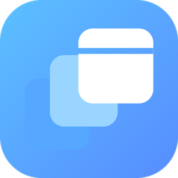

<p align="center">
  
</p>

# S11 Workspace

**Galaxy Tab S11을 우선 대상으로 만든 Android용 Windows 앱 작업공간입니다.** Wine과 Box64를 바탕으로 Windows 애플리케이션을 실행하고, 자체 작업 표시줄·시작 메뉴·파일 탐색기·설정 앱을 제공합니다. 원본 Winlator의 게임 중심 사용 경험을 그대로 유지하는 것이 아니라, 일반 앱과 생산성 작업에 맞춘 별도 제품 경험을 만드는 것이 목표입니다.

> 설치 파일: [최신 릴리스 다운로드](https://github.com/kim-kyum/winlator-app/releases/latest) · [전체 릴리스](https://github.com/kim-kyum/winlator-app/releases)

## 주요 기능

- Windows 앱을 실행하는 Wine/Box64 기반 컨테이너
- S11 Workspace 작업 표시줄, 시작 메뉴, 창 전환(Alt+Tab), 달력 및 알림 영역
- 한국어 우선 UI, 설정 앱과 통일한 내장 앱 아이콘, S11 전용 파일 탐색기
- 컨테이너 안에서 여는 설정 앱: 화면 해상도·배율(DPI), Wine 호환성·마우스 가속, 밝게/어둡게/시스템 테마, 배경화면, 앱·글꼴 관리
- `Win+Shift+S` 화면 캡처와 컨테이너 안에서 캡처를 모아 보는 Gallery 앱 (`C:\S11\Screenshots`)
- 작업 표시줄 Wi-Fi·Bluetooth 버튼과 설정 앱의 연결 페이지에서 Android 시스템 설정 열기
- 명령 프롬프트를 `C:\`에서 시작
- Android 기기의 기존 Winlator와 별도로 설치·실행

## 설치

1. [최신 릴리스](https://github.com/kim-kyum/winlator-app/releases/latest)에서 `S11-Workspace-build*.apk`를 받습니다.
2. Android에서 APK를 설치하고 앱을 실행합니다. 최초 실행 시 필요한 호환성 환경을 준비하는 데 시간이 걸릴 수 있습니다.
3. 컨테이너를 만든 뒤 시작 메뉴에서 앱을 실행하거나, 시작 메뉴의 **설정**에서 작업공간을 조정합니다.

S11 Workspace는 원본 Winlator와 다른 Android 애플리케이션 ID를 사용하므로 두 앱을 나란히 설치할 수 있습니다. 컨테이너 데이터는 각각 분리됩니다.

## 기기 및 호환성

- **주 대상:** Samsung Galaxy Tab S11 계열(ARM64 Android). Tab S11은 MediaTek Dimensity 9400+를 사용합니다.
- 다른 Android 기기에서도 실행될 수 있지만, GPU·드라이버·메모리와 Android 버전에 따라 결과가 달라집니다.
- 이 앱은 Windows 자체가 아닙니다. Windows용 x86/x64 앱의 실행 가능 여부와 기능은 Wine 호환성, CPU 변환, 그래픽 드라이버 및 앱별 요구사항에 좌우됩니다.
- Direct3D 경로는 API에 따라 다릅니다. WineD3D는 OpenGL 경로, DXVK는 Vulkan 기반 D3D9/10/11 경로, VKD3D는 D3D12 경로에 해당합니다. 드라이버가 필요한 기능을 지원하지 않거나 앱이 다른 API를 요구하면 렌더링 실패·검은 화면이 생길 수 있습니다.
- 브라우저와 무거운 x86/x64 앱은 ARM 기기에서 CPU 변환과 호환성 계층 때문에 느릴 수 있습니다.
- Autodesk Fusion 360 설치·실행을 비롯해 모든 Windows 앱의 호환성이 검증된 것은 아닙니다. 그래픽·전문 앱은 특히 기기 및 컨테이너 설정별 확인이 필요합니다.
- Wi‑Fi·Bluetooth 상태는 Android가 관리합니다. 작업 표시줄 버튼과 S11 설정의 연결 페이지에서 Android 시스템 설정을 열며, Wine에서 무선 라디오를 직접 켜고 끄지는 않습니다.

## 소스에서 빌드

Android APK 빌드에는 프로젝트에서 사용하는 JDK, Android SDK/NDK, CMake와 저장소에 포함된 앱 자산이 필요합니다.

```bash
chmod +x gradlew
./gradlew assembleDebug
```

Win32 작업 표시줄·설정·파일 탐색기·Gallery 실행 파일은 Wine의 Windows 헤더와 import libraries를 사용하는 clang/lld 빌드 스크립트로 생성합니다.

```bash
tools/s11/shell/build.sh <wine-11.x-directory> <output-directory>
```

S11 rootfs overlay를 다시 만들 때는 `zstd`가 필요합니다.

```bash
python3 tools/s11/build_overlay.py tools/s11/rootfs-overlay app/src/main/assets
```

GitHub Actions 워크플로는 브랜치에 푸시될 때 overlay와 APK를 빌드하고, 서명 설정이 가능한 경우 릴리스를 생성합니다. [워크플로 실행 내역](https://github.com/kim-kyum/winlator-app/actions/workflows/build-s11.yml)

## 기반 프로젝트 및 크레딧

S11 Workspace는 [Winlator](https://github.com/brunodev85/winlator) 소스에서 출발한 별도 포크입니다. 기존 저작권·라이선스 고지와 각 구성요소의 라이선스를 유지합니다. 구성요소별 고지는 저장소의 라이선스 파일 및 해당 프로젝트 문서를 확인해 주세요.

주요 기반 프로젝트:

- [Wine](https://www.winehq.org/)
- [Box86/Box64](https://github.com/ptitSeb)
- [Mesa](https://www.mesa3d.org/) — Turnip, Zink, VirGL 등
- [DXVK](https://github.com/doitsujin/dxvk)
- [VKD3D](https://gitlab.winehq.org/wine/vkd3d)
- [CNC DDraw](https://github.com/FunkyFr3sh/cnc-ddraw)
- [Selawik](https://github.com/microsoft/Selawik) 글꼴 및 기타 저장소 내 라이선스 고지 대상 자료

이 프로젝트와 기반 오픈소스 구성요소에 기여한 모든 개발자에게 감사드립니다.
